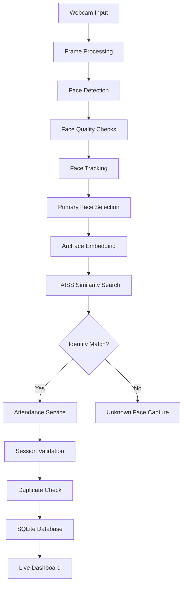

# attend

### AI-Powered Real-Time Facial Recognition Attendance Management System

**A privacy-focused, offline-first attendance management system built with Python, OpenCV, and ArcFace.**

[](https://www.python.org/)
[](https://www.microsoft.com/windows)
[]()
[]()
[](LICENSE)

---

## Overview

**attend** is a locally operated desktop application that automates student attendance using real-time facial recognition through a webcam.

Built with a Python-based computer vision pipeline, attend combines face detection, ArcFace facial embeddings, FAISS similarity search, and persistent face tracking to identify registered students and record attendance without requiring manual interaction.

The application is designed to run entirely on a local Windows machine, without cloud infrastructure, external web servers, or dedicated GPU hardware.

Its offline-first architecture keeps student records, biometric data, and attendance history under local control.

### Design Principles

- **Offline-first:** Attendance processing and data management happen locally.
- **CPU-only inference:** No NVIDIA GPU or CUDA environment required.
- **Privacy-focused:** Student records and biometric data remain on the local machine.
- **Reliable attendance:** Persistent tracking and session-based records prevent duplicate attendance entries.
- **Simple deployment:** A packaged Windows installer allows users to run the application without manually configuring Python.

---

## Features

### Real-Time Facial Recognition

- Multi-face detection through webcam input.
- Proximity-based primary face selection using face bounding-box size.
- ArcFace facial embeddings powered by InsightFace.
- FAISS-based similarity search for efficient identity matching.
- Configurable cosine similarity threshold.
- Face tracking to minimize repeated recognition and duplicate attendance events.
- Image quality checks for blur, face size, and pose.

### Attendance Management

- Two independently configurable daily attendance sessions.
- Separate attendance records for each session.
- Automatic attendance marking after successful identification.
- Duplicate attendance prevention within the same session.
- Manual attendance override for authorized administrators.
- Administrative action logging.

### Student Enrollment

- Individual student enrollment using photographs.
- Bulk enrollment from a local directory.
- Automatic FAISS index rebuilding after enrollment.
- Support for JPG, JPEG, PNG, and BMP images.

### Monitoring & Administration

- Live attendance dashboard.
- Real-time activity feed.
- Basic analytics integration hooks.
- Unknown face image capture.
- Seven-day unknown-face retention policy.
- Configurable attendance session timings.

### Local Storage & Security

- SQLite database for student and attendance records.
- Optional Fernet-based encryption helpers for biometric data.
- Local storage of student photographs, embeddings, logs, and configuration.
- No mandatory cloud connectivity or external database services.

---

## Technology Stack

| Component | Technology | Purpose |
|---|---|---|
| Programming Language | Python | Application development |
| Desktop Interface | PySide6 | Native desktop GUI |
| Computer Vision | OpenCV | Webcam access and image processing |
| Face Detection | InsightFace | Face detection |
| Face Recognition | ArcFace | Facial feature extraction |
| Vector Search | FAISS | Embedding similarity search |
| Inference Runtime | ONNX Runtime | CPU-based model inference |
| Database | SQLite | Persistent local storage |
| ORM | SQLAlchemy | Database models and queries |
| Encryption | Cryptography | Optional biometric encryption |
| Packaging | PyInstaller | Windows application bundling |
| Installer | Inno Setup 6 | Windows installer generation |

---

## System Architecture

The application follows a modular architecture that separates computer vision, business logic, persistence, and presentation.



### Recognition Pipeline

1. Capture frames from the connected webcam.
2. Detect faces present in the current frame.
3. Evaluate face quality using size, blur, and pose checks.
4. Track detected faces across consecutive frames.
5. Select the primary face based on proximity estimation.
6. Generate facial embeddings using ArcFace.
7. Search registered embeddings using FAISS.
8. Compare the similarity score against the configured threshold.
9. Validate the active attendance session.
10. Record attendance while preventing duplicate entries.

---

## Requirements

| Requirement | Specification |
|---|---|
| Operating System | Windows 10 / 11 |
| Python | 3.10–3.12 |
| Camera | Webcam |
| Processor | CPU with AVX support preferred |
| GPU | Not required |
| Storage | Approximately 2–4 GB free space |
| Internet | Required for initial model download only |

### Dependencies

Install the dependencies listed in `requirements.txt`.

Main packages include:

- `PySide6`
- `opencv-python-headless`
- `insightface`
- `onnxruntime`
- `faiss-cpu`
- `SQLAlchemy`
- `cryptography`

---

## Getting Started

### 1. Clone the Repository

```bash
git clone https://github.com/YOUR_USERNAME/attend.git
cd attend
```

### 2. Create a Virtual Environment

```bash
python -m venv venv
```

Activate it on Windows:

```powershell
venv\Scripts\activate
```

### 3. Install Dependencies

```bash
pip install -r requirements.txt
```

### 4. Launch the Application

```bash
python -m app.main
```

### First Launch

On the first launch, InsightFace downloads the `buffalo_l` model pack into the local models directory.

An internet connection is required for this initial download. Once the model is available locally, facial recognition can operate without an internet connection.

---

## Usage

### 1. Student Enrollment

Navigate to the **Enrollment** tab.

For individual enrollment:

1. Enter the student's ID.
2. Enter the student's name.
3. Select a clear, frontal photograph.
4. Click **Enroll Student**.

For bulk enrollment, select a directory containing student photographs.

**Supported filename conventions:**

| Filename | Student ID | Student Name |
|---|---|---|
| `S001_Alex_Smith.jpg` | S001 | Alex Smith |
| `S002_John_Doe.png` | S002 | John Doe |
| `S003.jpg` | S003 | S003 |

Supported image formats: `.jpg`, `.jpeg`, `.png`, `.bmp`.

The FAISS index is automatically rebuilt after enrollment.

### 2. Live Attendance

The default attendance sessions are:

| Session | Start | End |
|---|---|---|
| Morning | 09:00 | 13:00 |
| Afternoon | 14:00 | 18:00 |

During an active session:

- The webcam continuously processes incoming frames.
- The system identifies the primary face.
- A successful identity match triggers attendance marking.
- Repeated appearances do not create duplicate attendance records within the same session.

### 3. Manual Attendance Override

If facial recognition or the camera is unavailable, an administrator can use the **Manual Mark** tab.

Provide the student's ID and optionally specify a reason.

Manual attendance entries are recorded as administrative overrides.

### 4. Application Settings

Administrators can configure:

- Facial recognition similarity threshold.
- Morning session start and end times.
- Afternoon session start and end times.

The default cosine similarity threshold is approximately `0.42` and should be calibrated against the enrollment dataset and real-world operating conditions.

---

## Windows Application Packaging

attend supports standalone Windows packaging so end users do not need to install Python or manually manage dependencies.

### Build Requirements

- Windows 10/11
- Python 3.10–3.12
- Inno Setup 6
- Project dependencies

### Build Instructions

**1. Create the virtual environment**

```powershell
python -m venv venv
```

**2. Install application and build dependencies**

```powershell
venv/Scripts/python -m pip install -r requirements.txt -r requirements-build.txt
```

**3. Build the application bundle**

```powershell
powershell -ExecutionPolicy Bypass -File scripts/build_windows.ps1
```

**4. Generate the Windows installer**

```powershell
powershell -ExecutionPolicy Bypass -File scripts/build_installer.ps1
```

### Installer Details

The generated installer:

- Installs the application per-user under `%LOCALAPPDATA%/Programs/attend`.
- Adds a Start Menu shortcut.
- Offers an optional desktop shortcut.
- Provides an option to launch the application after installation.

The installer is generated at:

```text
dist/attend.exe
```

The first application launch downloads the InsightFace recognition model. Subsequent launches can operate offline.

Application data is stored under:

```text
%LOCALAPPDATA%/Attend/
```

This directory contains the local database, configuration, student photographs, logs, and downloaded recognition model.

**Note:** Student records and biometric data are not bundled with the installer. Each machine requires its own student enrollment.

---

## Project Structure

```text
attend/
│
├── app/
│   ├── main.py
│   │
│   ├── core/
│   │   ├── config.py
│   │   ├── database.py
│   │   ├── models.py
│   │   └── security.py
│   │
│   ├── vision/
│   │   ├── pipeline.py
│   │   ├── recognizer.py
│   │   ├── tracker.py
│   │   └── quality.py
│   │
│   ├── services/
│   │   ├── attendance_service.py
│   │   └── enrollment.py
│   │
│   ├── ui/
│   │   └── main_window.py
│   │
│   └── utils/
│       ├── camera.py
│       └── logging_setup.py
│
├── data/                       # Runtime-generated data
│   ├── attend.db
│   ├── faces/
│   ├── unknowns/
│   └── faiss_index/
│
├── models/                     # Recognition models
│
├── scripts/
│   ├── build_windows.ps1
│   └── build_installer.ps1
│
├── tests/
│
├── requirements.txt
├── requirements-build.txt
└── README.md
```

---

## Performance Considerations

attend is designed for CPU-only inference and uses several optimizations to reduce processing overhead.

| Optimization | Purpose |
|---|---|
| Frame skipping | Reduces unnecessary inference calls |
| Smaller detection resolution | Reduces face detection overhead |
| Persistent tracking | Minimizes repeated recognition |
| FAISS similarity search | Efficient embedding lookup |
| CPU-based ONNX Runtime | Avoids dedicated GPU requirements |

The target recognition latency is below **300 ms** under controlled conditions.

Actual performance depends on processor capabilities, camera resolution, lighting conditions, number of detected faces, and model configuration.

---

## Privacy & Security

Facial recognition involves sensitive biometric information. attend is designed around local data processing, but local execution alone does not guarantee complete data security.

Key considerations:

- Student photographs, biometric embeddings, and attendance records are stored locally.
- Optional Fernet encryption helpers are available for biometric data.
- Unknown face captures follow a seven-day retention policy.
- Administrative attendance overrides are logged.
- No cloud-based processing is required.

Institutions deploying attend should establish appropriate consent procedures, access controls, data retention policies, and biometric data protection measures before production use.

---

## Limitations & Future Work

The following areas remain candidates for further development:

- [ ] Liveness detection and presentation attack prevention.
- [ ] Complete unknown-face gallery and management interface.
- [ ] Advanced attendance analytics and reporting.
- [ ] Comprehensive recognition accuracy evaluation across different lighting conditions, camera qualities, and facial angles.
- [ ] Improved recognition threshold calibration.
- [ ] Additional administrative access controls.
- [ ] Expanded automated test coverage.

**Important:** Liveness detection is not currently implemented. A photograph or video displayed to the webcam may be used to spoof recognition.

---

## Development

### Running Tests

```bash
pytest tests/
```

### Code Formatting

```bash
black app/
```

Contributions involving bug fixes, performance improvements, recognition accuracy, testing, and security are welcome.

For substantial changes, consider opening an issue first to discuss the proposed implementation.

---

## Contributing

Contributions are welcome.

1. Fork the repository.
2. Create a feature branch.
3. Implement your changes.
4. Add or update relevant tests.
5. Submit a pull request with a clear description of the changes.

Please ensure that changes preserve the offline-first architecture and CPU-only compatibility.

---

## License

This project is distributed under the MIT License. See [LICENSE](LICENSE) for details.

---

<p align="center">
  <strong>attend</strong><br/>
  Local processing. Automated attendance. Privacy-conscious design.
</p>
